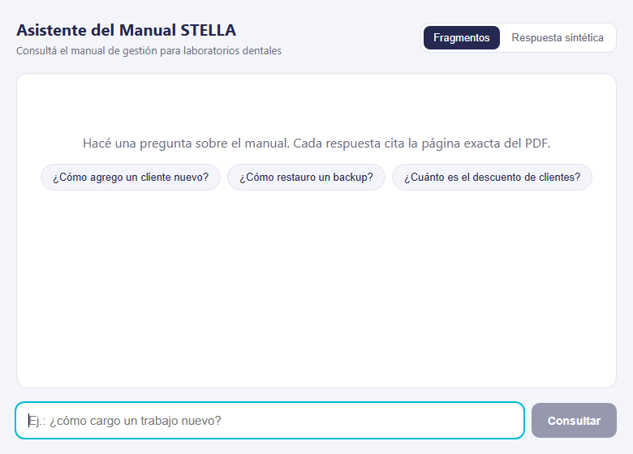

# Asistente RAG de proyectos

**Asistente que responde preguntas sobre la documentación de mis proyectos y cita proyecto, documento, sección y página.**

🔗 **Demo:** https://rag-proyectos.vercel.app · también desde el portfolio en `/asistente/`



## El problema

Los usuarios de SolutionsCars y STELLA hacían preguntas que ya estaban respondidas en la documentación. El asistente encuentra la respuesta y muestra de dónde sale.

## Cómo funciona

- **Búsqueda híbrida:** BM25 (palabras clave) + FAISS (semántica con `bge-m3`, 1024 dimensiones, vía Cloudflare Workers AI), combinadas con Reciprocal Rank Fusion.
- **Citas verificables:** cada respuesta indica `Proyecto · Documento · Sección (pág. N)` y, si el PDF es público, el link abre esa página.
- **Sin relleno:** si la pregunta no tiene que ver con la documentación, responde que no encontró nada en vez de inventar.
- **Dos modos:** fragmentos citados o respuesta redactada por un LLM (Groq) en streaming (SSE).
- **Nunca queda roto:** sin LLM responde con fragmentos; si falla la búsqueda semántica sigue con BM25.
- **Protección:** rate limit por IP, cupos diarios, errores saneados y headers de seguridad (CSP).

## Stack

FastAPI + SSE · FAISS · BM25 · Cloudflare Workers AI · Groq · Upstash Redis · React 19 + Vite · pytest · GitHub Actions · Vercel.

## Calidad

- 151 tests con pytest y un set de evaluación de 44 preguntas en español.
- En ese set, la búsqueda híbrida acierta 38/44 en el top 3 y 43/44 en el top 5 (BM25 solo: 36/44 y 38/44).
- El CI corre tests, lint y build. La ingesta bloquea documentos con claves, tokens, CUIT/CUIL o emails no autorizados.

## Cómo correrlo

```bash
uv sync --frozen
uv run uvicorn app.main:app --reload   # API en :8000
cd client && npm install && npm run dev  # UI en :5173
uv run pytest
```

Las variables de entorno están documentadas en `.env.example`. Para sumar un proyecto, se agregan sus documentos a `corpus/<proyecto>/`, se registra en `corpus/manifiesto.json` y se reindexa con `scripts/ingest.py`.

## Estado

En producción (fases 0–11 completadas). Próximas mejoras: reranker, ajuste del peso semántico y más preguntas de evaluación.

## Autor

Lautaro Rodríguez · [GitHub](https://github.com/Rahyned)
